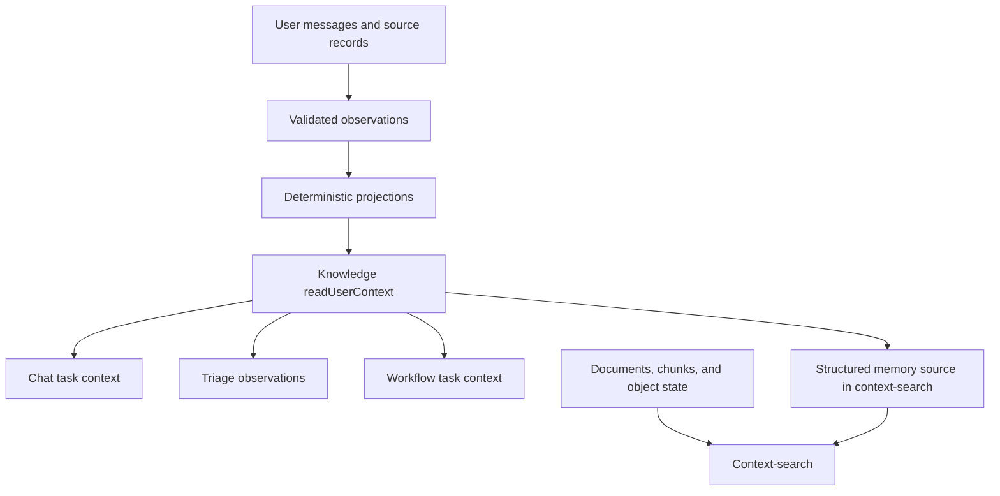

# Shared context memory: implementation order

Alfred must learn once and use the same knowledge in chat, email tagging, and user-defined workflows. Each decision must receive the relevant knowledge with its source, time, status, and uncertainty. A user correction must change the next decision in all three surfaces.

This plan implements [ADR-0111](../decisions/ADR-0111-structured-workspace-memory-claims-sweep-curiosity.md), including D2b's time rules, on the [ADR-0067](../decisions/ADR-0067-multi-source-user-model-substrate-an-event.md) observation log. It proposes updates to older implementation plans where their destinations conflict. It does not approve new production activation or replace the existing integration action policy.

## 1. First result to ship

In a work-scoped chat, the user says: "Dev owns billing from October 18. Maya handed it over."

1. Alfred resolves the people and workspace. An ambiguous name stays unresolved until it can be resolved from evidence or the user selects a person.
2. The accepted correction is stored with the actual user message, its date, and the effective date. The prior claim remains in history.
3. A new chat can answer who owns billing and cite the correction.
4. Triage can use the same claim as context for a message about billing. It still classifies the message's actual ask.
5. A user-defined workflow about billing receives the same claim without depending on the model to discover the memory tool.
6. The user can inspect, change, or reject the claim. The next reads show that change.

This result is the first release. Broad passive learning, web research, full graph traversal, and new autonomous actions are not prerequisites.

## 2. What exists, and what is missing

These are code observations, not a new measurement of the production database.

| Part | Existing implementation | Missing work |
| --- | --- | --- |
| Evidence log | `knowledge/observations.ts` validates writes, deduplicates evidence, and maintains family heads. | Typed claim payloads, workspace attribution, source-message references, and time semantics for new writers. |
| Entity graph | Stable nodes and typed identities; Gmail kind and grounded `works_at` folds; active-version reader and refold machinery. | Shared consumer reads, broader grounded relationships, and verified activation. A missing active projection still gives an empty read. |
| User memory | `user_facts`, preferences, instructions, chunks, and review mutations. | One observation-backed writer for each migrated kind; the HTTP fact mutators currently write facts directly. |
| Chat capture | Idle trigger, transcript loading, and tagged proposition extraction. | The final step has `TODO(#399)`. Extracted propositions have no source message id or effective-date contract. |
| Context search | Registered document, memory-chunk, object-state, and Drive sources; ranking, packing, and bounded expansion. | A source for structured user/workspace memory, using active graph identities. The current memory source recalls chunks. |
| Chat reader | `readUserContext` reads facts plus old `entities` and `entity_relations`. | Dates and sources in returned fact items; current graph and workspace claims; an entry read. |
| Triage reader | Sender priors, narrow instructions, legacy contact/relationship reads, optional active sender kind, and a cold-start context line. | Supported workspace claims from the same memory reader. No general memory search belongs on this path. |
| User-defined workflow runner | Database-authored workflows resolve to the shared brief runner. Its prompt asks the model to call `system.read_user_context`. | A mandatory local context read at entry, workspace binding, refresh rules, and a read trace. |

Primary code: [observation writer](../../packages/assistant/src/knowledge/observations.ts), [active graph reader](../../packages/assistant/src/knowledge/reader.ts), [chat capture](../../packages/assistant/src/chat/chat-memory-capture.ts), [chat proposition contract](../../packages/contracts/src/chat-memory.ts), [current context reader](../../packages/assistant/src/knowledge/user-context.ts), [fact mutations](../../packages/http/src/sync/write/facts.ts), [triage context assembly](../../packages/assistant/src/triage/workflow-operations.ts), [workflow resolution](../../packages/assistant/src/execution/resolve-workflow.ts), and [brief runner](../../packages/assistant/src/execution/workflows/user-authored-brief.ts).

## 3. Target ownership and shared interface



- `@alfred/contracts` owns browser-safe observation payloads, scope, time, and read-result schemas. Types derive from those schemas. Existing provider and evidence contracts remain their owners.
- `@alfred/db` owns tables, constraints, and inferred row types. Schema changes use `pnpm db:generate`, then `pnpm db:migrate`.
- `@alfred/assistant/knowledge` owns capture acceptance, identity resolution, projection policy, memory selection, and the shared read. Runtime composition installs adapters through the existing tool-runtime seams.
- `context-search` remains the broader evidence-search module. Its structured memory adapter calls knowledge. Knowledge does not call context-search back. Live provider reads stay behind existing tools and adapters.
- `@alfred/sync` owns the browser read models and mutation arguments. HTTP adapts authenticated mutations to knowledge-owned operations in the supplied transaction.

Evolve `readUserContext`; do not add a competing generic memory module. Its request describes the task and the available scope: authenticated user, workspace or explicitly selected workspaces, query or known subject/object identities, evaluation time, and a bounded local-read allowance. The caller cannot select a different user through model input. Triage passes exact subjects; chat and a workflow can also pass task text. The implementation must not switch on feature names to decide what a fact means.

The shared result contains relevant user facts, entity/relationship knowledge, workspace claims, and applicable instructions as distinct item kinds. Each item carries its stable logical id, subject, source references, status, known time fields, and currency assessment. The result also carries the evaluation time, projection revision/watermark, omitted-item count, and section-level `ok`, `empty`, `unavailable`, or `not_active` reports. A failed reader must not look like an empty memory.

The structured read is a local database operation: no embedding, model, or provider call. Query matching starts with exact identities and bounded lexical relevance. Larger evidence discovery uses context-search. Provider verification is an explicit later operation. Applicable instructions get a separate allowance so ordinary facts cannot evict them. Existing deterministic instruction effects are marked as applied and are not applied again as prose.

### One owner for each kind of knowledge

| Knowledge | Durable authority | Derived/read home |
| --- | --- | --- |
| Facts about the user | Grounded observations; migrate ownership by fact kind | Existing `user_facts` projection/read model, per ADR-0080 |
| People, organizations, teams, identities, and relationships | Source observations and accepted identity bindings | `entity_nodes`, `entity_identities`, active profiles/edges |
| Claims about a workspace | Claim observations with source references | New versioned workspace-claim projection and history |
| User instructions | Explicit user instruction observations | Existing instruction read model, with v1 compatibility |
| Provider lifecycle state | Existing provider receipts/reducers and verification rules | `integration_objects` and its keys |
| Episodic recall | Source-linked existing memory chunks | Existing chunk recall; a distilled note keeps lower authority than its source |

Claim ends use ADR-0111 D2a's stable node id or object identity tuple. A PR that already has an integration object gets no duplicate graph node. This work adds no new write to the old `entities.metadata` graph. It creates no separate generic work-item table.

## 4. Time and scope rules to settle before the first migration

1. **Keep the clocks distinct.** Retain source `occurredAt`; use observation `createdAt` as recording time only after confirming that retries and imports preserve its meaning. Replays never reset it. Raw document arrival is a separate event. Derive first learning, newest support, accepted change, and verification times from their evidence.
2. **Represent uncertainty.** New claim validity can be unknown. An exact instant and a local calendar date are different values; a calendar date carries its zone. Use existing `LocalDateKey`, `IanaTimezone`, settings, and time helpers. Do not silently copy a row creation date into an unknown effective date.
3. **Separate expiry from truth.** A review deadline or recheck date must not become `validUntil`, which says the fact stopped applying. An expired proposal can leave the active review set without asserting that the underlying statement became false. This amends the older chat plan's use of a three-day TTL as validity.
4. **Separate transport from authority.** The authenticated user's correction has user authority whether it arrives through chat or settings. A model does not choose that authority. The writer validates the cited message's role, ownership, and quoted evidence. A later automatic inference cannot undo the correction; a later explicit user correction can.
5. **Keep history recoverable.** Store immutable evidence and accepted supersession decisions from the first slice. Define both effective-time and knowledge-time selection before storage ships. The historical reader ships later; until then historical requests must report unsupported/unknown rather than return current state as history. Reconstructing a past view must not use today's family heads as if they were the heads then.
6. **Bind workspace explicitly.** Implement ADR-0111's one-email-account workspace with a durable id that survives credential deletion. Map credential lifecycle, provider org/workspace connections, and workflow scope to it. Personal mail gets its own workspace. User identity/preferences can be global; workspace claims cannot leak through that global section.
7. **Scope every caller.** Triage uses the receiving account's workspace. A workflow revision records its workspace binding when approved, with the trigger scope checked at execution. An unbound legacy workflow gets global user context and a missing-scope report, not every employer's claims. Chat may deliberately read several workspaces, with each item labeled. If a write's workspace is ambiguous, it cannot become an active workspace claim.
8. **Keep a stable claim lineage.** Use normalized subject, predicate, workspace, and qualifiers to identify a single-valued slot; values can change within it. Multi-valued claims remain independent. Free labels remain display vocabulary. A hash of a prose sentence alone cannot decide equivalence or conflict. Ambiguous equivalence produces a proposal, not an automatic merge.

Proposed implementation choice: new claims support unknown/precise validity in their own contract. Existing non-null `user_facts.validFrom` rows need a migration strategy for uncertain dates; do not change that column's meaning by convention alone. Slice 1 must record the exact storage form and legacy mapping before it generates a migration.

## 5. Build order

Each numbered slice is a reviewable deliverable. Split a slice into dependent PRs where contracts, migrations, and consumers require it. A schema-only PR is a dependency, not a product release.

### Slice 0 — Reconcile the plan and inventory the rollout

**Depends on:** this review. **Result:** one implementation destination.

- Amend the older chat plan's legacy `entities.metadata` destination and unchanged-reader assumption. Keep its useful authority and attribution requirements. Update #400's scope before implementation; do not build its old destination first.
- The three-day proposal deadline is a review-status change, not a validity change: it never writes `valid_until` (see `chat-memory-capture-v1.md` D3 and ADR-0111 D2b). Keep instructions, fact review status, and evidence currency separate.
- Record current schema versions, existing active projection pointers, input counts, source coverage, namespace availability, and current triage latency/cost. Production values require a read-only preflight; this plan does not claim them.
- Checksum complete output for a new claim fold. Existing Gmail auto-refold checks kind output only; it does not prove claim or relationship determinism.
- Record known-good and known-wrong real examples under `references/`, with stable source ids. Do not copy private source bodies into tracked prose.

**Exit:** a build starts from current code and clear cutover ownership; archived issue wording cannot select a second writer.

### Slice 1 — Add scope, temporal contracts, and the claims substrate

**Depends on:** 0. **Main homes:** contracts, DB schema, credential lifecycle, workflow revision scope.

- Add the durable workspace map, provider mapping, active/archive status, and the scoped claim projection/history described above. Disconnection must not cascade-delete an archived workspace. Full archive/delete UI can follow, but persistence semantics must already be correct.
- Define strict observation payloads for assertion, correction, rejection, and supporting evidence. Preserve source message/document ids, excerpt locators, effective dates, predicate/cardinality, and resolved endpoints. Register a new observation source/kind only with its first writer.
- Add the shared read-result contract and versioned projection metadata. Preserve tenant and workspace ownership through database constraints where possible. Parse persisted/protocol data at its owner.
- Specify logical sync keys and content versions before exposing new projections to Replicache. A projection activation must not delete and re-add every unchanged row.

**Exit:** a candidate claim and its evidence can be represented without losing attribution, scope, or unknown dates. Migrations apply in development, and existing readers still work.

### Slice 2 — Build the projection and one correction operation

**Depends on:** 1. **Main home:** knowledge.

- Build a deterministic fold from accepted observations into scoped claims and relevant existing user-fact projections. Confidence derives from grounding and independent support; model confidence is a capture hint, not permission to confirm.
- Resolve hard identities through existing identity primitives. A name-only mention stays unresolved/proposed. Register new writable identity kinds only with a real, validated writer. Do not invent an email or fuse two people by name.
- Add a knowledge-owned assertion/correction/rejection operation that accepts the caller's transaction. It appends evidence and updates or schedules the projection with a durable retry path. An accepted direct correction must be visible to the next read before Alfred says it is remembered; a delayed projection returns an honest pending result.
- Move create/edit/confirm/reject paths for each migrated fact kind through that operation, including HTTP/sync mutations. Convert trustworthy existing user edits into observations before cutover. Leave unsupported legacy inferences inactive or explicitly labeled; do not promote them to user authority.
- Complete and validate the new run before activation. Use per-user serialization or compare-and-swap activation so a slow older run cannot replace a newer correction. Preserve a read watermark for lag detection.
- Keep a minimal source/undo read and correction path available before autonomous learning is enabled. A reversal is new evidence, not deletion of the audit history.

**Exit:** the same evidence, cutoff, and evaluation instant produce the same claim set; a retry creates no extra support; a user correction beats weaker evidence across all write routes.

### Slice 3 — Finish chat capture and immediate explicit writes

**Depends on:** 2. **Main homes:** chat capture, extractor, tool contracts and knowledge adapter.

- Finish #399 using the existing idle trigger. Give extraction input message ids, roles, timestamps, and source references. Require evidence references in each candidate, then validate those references against the loaded thread.
- Give each source statement a retry-stable evidence identity. Re-extracting the whole thread must not turn one message into several independent confirmations. Persist progress at a message watermark; process a later correction even if it quotes an earlier turn.
- Generalize the in-band write capability for explicit durable facts/corrections through the same operation. Keep current `system.remember` suppression calls compatible until the ADR-0113 migration converts the v1 rows; the v2 arm writes scope, targets, and chosen effects, and never expands a class into a sender list.
- Capture user assertions as user evidence. Assistant text without its original external evidence cannot become a confirmed fact or an independent corroborating source. The current registry has no enrichment writer; unsupported enrichment stays out until a source-backed writer exists.
- Keep conversation-only requests in run context. A model-generated workflow summary is not a user assertion or standing instruction.

**Exit:** a correction survives a new chat, ordinary durable statements can be learned after idle, and both use the same evidence/projection path. Source ownership, duplicate capture, and quoted-content ambiguity are visible in traces.

### Slice 4 — Make the shared reader authoritative

**Depends on:** 2; use 3 for the first real chat evidence. **Main homes:** knowledge reader and context-search adapter.

- Evolve `readUserContext` to the contract in section 3. Read active graph projections through `userModelReader`, and scoped claims through their equivalent active reader. Keep global user facts/preferences distinct from workspace claims.
- Add one structured memory source to the existing context-search registry; reuse its capability manifest, ranker, and `packEvidenceCards`. Keep chunk recall as episodic evidence. Suppress duplicate presentations of the same evidence and never count chunk plus source as independent support.
- Centralize active instruction selection behind the same knowledge module, while retaining separate instruction status and deterministic enforcement. Triage receives the scoped instructions with their ids and returns the matched ids (ADR-0113); code applies the stored effects. A stored match carries the document revision, the instruction-set revision, and each instruction revision; a later reader applies it only while those revisions are current (ADR-0113, "Lifetime of a stored match"). Known instructions cannot disappear merely because claim ranking filled the text allowance.
- Distinguish missing activation, read failure, no match, conflict, and stale evidence. A canonical read failure cannot resurrect an older legacy value. Legacy compatibility is an explicit migration section, not a silent second authority.
- Start with database reads. If measurements later justify a cache, key by user, scope, request, and relevant content revision. Correction/rejection, expiry checks, and disconnect must invalidate or bypass cached results. A replay alone is not fresh verification.

**Exit:** one scoped call supplies cited, dated, bounded memory. Exact subject reads work without embedding or model calls; missing projections yield a typed report.

### Slice 5 — Connect chat, tagging, and workflows; release the first result

**Depends on:** 3 and 4. Ship the following adapters as small dependent changes.

| Consumer | Entry read | Refresh and failure behavior |
| --- | --- | --- |
| Chat | Local task context from the current request and known subjects; tools expand it on demand. | Refresh at a new user turn or after a successful memory write. Report partial reads. Preserve the stable system-prompt hash; task context is an ephemeral reference placed with the current request. |
| Email tagging | Receiving workspace, exact sender/subject identities, relevant active instructions, and at most five supported workspace claims in observations. | One bounded local read per classify decision. No web, embedding, reconciliation, or curiosity call on the tagging path. Ordinary context failure falls back to message/thread evidence with a trace; existing protective instruction behavior stays intact. |
| User-defined workflow | Approved workspace binding, brief, trigger, and known objects; local context is loaded by the runner before its first judgment. | Refresh after a durable wait/approval, a memory write, or a revision change affecting the task. A provider action still requires the existing policy and current provider evidence. Missing scope/critical instructions parks or reports the affected decision; it does not broaden scope. |

- Reuse the existing tool-runtime knowledge adapter. Generalize the existing ephemeral-context assembly where needed; avoid copying a separate context loader into each runner.
- Have both chat and the brief runner expose the same read and evidence-search tools for deeper questions. Sub-agents inherit the parent's authorized scope and can only narrow it.
- Treat selected facts as evidence, and explicit instructions as instructions. Historical transcript text can contain superseded memory; refreshed context identifies the current lineage/revision and marks the older value superseded.
- Refresh when facts relevant to an action have changed. Do not inject every graph update into every model turn. Log the memory item ids and revisions used by a decision so a later correction does not rewrite the decision's history.
- Preserve honest tagging and security floors. Relationship/claim context can explain relevance; it cannot invent an ask, assignment, urgency, or a provider status. Only an explicit applicable instruction can request an allowed category override, with its audit breadcrumb.

**Exit / release gate:** the section 1 correction is read by all three consumers with the same claim id and revision. A related email uses the claim; an unrelated email receives no irrelevant claim. The user can reverse the correction. Prompt bytes, database time, and model cost are measured. This is the first shared-memory release.

### Slice 6 — Add passive workspace learning from Gmail

**Depends on:** first shared-memory release. **Main homes:** knowledge capture workflow and existing runtime registration.

- Implement ADR-0111's separate reconciliation sweep about every two hours, with an on-demand entry, initially over ingested Gmail documents plus their observations. Reuse exact object keys and known entities. Load full source context when the triage event payload is insufficient.
- Select meeting-summary candidates before category exclusions. A mistaken `newsletter` tag or an unsubscribe footer must not hide their source content. Recognition uses content and source metadata, not a notetaker sender allowlist. Learning workspace claims from notes does not adopt every attendee's action items as todos; ADR-0092's ownership rules still apply.
- Keep the existing extractor's user-aboutness guard. The new writer learns workspace claims; it does not loosen identity extraction or add a model call to triage.
- Use a durable recording cursor plus a captured upper bound. A newly imported old email must be processed even though its source time is before the previous sweep. Commit cursor movement only for durably handled input; a failed group remains retryable.
- Group by grounded identities. Batch within explicit input/output and spend limits; "one call per sweep" must not mean one unbounded prompt. Commit accepted observations through the same typed write operation. Store provider receipts as evidence rather than copying provider state into claims.
- Record picked, skipped, grouped, proposed, accepted, rejected, unresolved, and failed counts separately. No claims in a quiet corpus can be the correct result.
- Begin with a small shadow window. Implement the approved backfill of up to 90 days, newest first, with the $2.40 per-account ceiling. Measure how much history fits before enabling it broadly. Backfill never resets original source dates or grants verification.

**Exit:** an email-derived claim reaches all three readers; an old imported message cannot replace a newer user correction; replay and repeated sweeps do not inflate support.

### Slice 7 — Extend grounded sources and the review surface

**Depends on:** 6. Extend one source at a time.

- Add Calendar, GitHub, or other connected source reducers only where real data gives missing knowledge. Start with hard keys and explicit participation. Do not infer a manager from CC, employment from a domain, or headcount from the number of visible senders.
- Map each provider org/workspace to the memory workspace. Reuse object-state and its key index; broaden entity resolution only with reversible, evidence-backed bridges.
- Extend `/memory` with workspace claims, citations, known time fields, revision history, currency, and edit/reject controls. Route these through the same operations from slice 2. Keep Replicache logical ids stable across projection rebuilds.
- Complete archive/delete choices on disconnect. Archived claims are labeled historical and never drive live tagging or verification. Explicit deletion must remove or redact source evidence as well as projections so replay cannot restore deleted memory; define that retention change before enabling deletion.

**Briefing claim reader (ADR-0111 D7).** This is a separate deliverable of this slice. It does not block the first release in slice 5. It needs ADR-0092 A1, A1a, and S2 first, so that each briefing item carries the key of its thing.

- **Scoped read.** Load claims only for the referents of the items in that briefing, and only from the item's workspace. Use the same shared reader and operation as slice 4. Do not run a general memory search.
- **Dates and currency.** Show each claim with its evidence date, its validity, and its currency for the task (D2b). A claim past its `recheckAfter` shows a flag, for example "Connect Linear to confirm". The briefing never states it as current fact.
- **Failure.** A read failure or a missing projection leaves the briefing item without claims, and the trace records the typed read status. A failure never blocks the briefing, and it never returns an older legacy value.
- **Correction.** The user can correct or reject a claim where the briefing shows it, through the slice 2 operation. The next briefing and the other readers show the change. Log the claim ids and revisions that each briefing used.

**Continuing context (owner decision of 2026-10-21, [product-direction §10d](../theory/product-direction.md)).** The scoped read above adds claims only to items that something else selected. That is not sufficient. A meeting summary whose mail is `fyi` would enter memory and never reach a briefing, and a continuing project or job search would disappear on a quiet day. Today briefing gather has no memory input at all: it reads the triage digest, calendar, weather, and integration activity (`briefings/gather.ts`), and `isQuietMorning` reads only activity, meetings, and mail counts (`briefings/read.ts`). Thus this slice adds a bounded candidate source:

- **Candidates.** Claims in the user's own workspace that are about work the user takes part in, that are still valid at `asOf`, and that got new support since the previous briefing or are open with a date in the briefing window. A meeting summary learned from notes mail is a candidate on the next briefing after it is learned, whatever the category of its mail.
- **Bound.** At most a small fixed number of candidates for each briefing, chosen by recency of support and significance. The number is set from measurement before rollout. The trace records selected and omitted counts.
- **Selection, not a fact.** A candidate enters the same selection as the other inputs. The model chooses and orders it, as the owner decision allows. It shows with its evidence date and currency (D2b), and it is never stated as current fact past its `recheckAfter`.
- **Independent of todos and mail.** The source does not need new priority mail or the todo surface. A quiet morning with a selected candidate is not quiet for `isQuietMorning`.
- **Failure.** A read failure gives no candidates and a typed status in the trace. It never blocks the briefing.

**Exit:** another source reinforces the existing claim instead of creating another authority; corrections and archived scope behave the same in every reader and review surface. A briefing item with a known referent shows its dated, scoped claims, and a correction made in the briefing reaches chat, triage, and workflows. On a day with no new priority mail, a briefing can select a continuing-context claim, and a meeting summary from `fyi` mail can reach the next briefing.

### Slice 8 — Add bounded verification and curiosity

**Depends on:** 6 and the review/correction controls. Broader source coverage from 7 can grow independently.

- Use `recheckAfter` or an equivalent review schedule, evidence currency, significance, and task relevance to select gaps. A low-confidence claim is not proof that web research will help.
- Verify against a connected source first, mailbox evidence second, and public sources last. Preserve ADR-0111's limits on person research and personal workspaces. Register an enrichment source only with the writer that supplies traceable original evidence.
- Record verification outcomes and actual source currency. Re-reading a cache, rephrasing a chunk, or obtaining no contradictory result does not confirm a claim.
- Run scheduled curiosity at night after user-fact extraction and before the morning briefing, with an on-demand entry for a relevant gap. Use the user's configured zone and existing scheduling helpers.
- Meter sweep and curiosity calls through the existing cost log. Preserve the approved $0.75/day shared allocation and the explicit exception: a sweep continues when that allocation is exhausted; curiosity gets only the remainder. Account for reservations across concurrent jobs so curiosity cannot spend the same remainder twice. Bound each sweep batch, its retries, and its workflow run; save progress and queue continuations for excess input. Report sweep overrun separately. This allocation is not an absolute ceiling on all memory calls. Changing that rule requires a new decision.
- Recheck freshness on use. Verification can update memory, but taking an external action stays under existing integration policy. Automated action proposals are a separate later slice.

**Exit:** useful evidence is renewed with measured spend, the approved sweep-priority behavior, bounded runs, and no false freshness.

### Slice 9 — Historical reads and retirement of migration paths

**Depends on:** the earlier canonical writers/readers and retained history.

- Expose effective-time and knowledge-time reads through the shared reader after replay validates both against original observation recording times. A later correction must not appear in an earlier knowledge snapshot.
- Validate date-only and unknown validity, future-effective changes, out-of-order arrivals, and concurrent corrections. A historical query to an unversioned provider must report that provider state at the requested time is unavailable.
- Retire legacy graph reads/writes only after counts, real cases, and consumer traces show coverage. Remove replaced contact/context helpers rather than leave a second learning path.
- Keep per-kind migration ownership explicit until all required user-fact writers use observations. Do not mark the full ADR-0080 migration complete because the workspace-claim slice shipped.

**Exit:** historical answers are honest, and each migrated kind has one durable authority and one shared read policy.

## 6. Dependency order

```text
0 plan reconciliation
  -> 1 scope + contracts + schema
  -> 2 projection + correction operation
       -> 3 chat writes
       -> 4 shared reader
          -> 5 chat + triage + workflow adapters [first release; requires 3 and 4]
             -> 6 Gmail reconciliation and measured backfill
                -> 7 more sources + complete review/archive controls + briefing claim reader [reader requires ADR-0092 A1, A1a, S2]
                -> 8 verification/curiosity [requires review/correction controls]
             -> 9 historical reads + retirement [after coverage is proved]
```

Full significance scoring, Directory access, arbitrary graph traversal, and public research do not block slice 5. Activation and rollback checks apply at each projection cutover; there is no final switch that enables all new memory at once.

## 7. Existing issue and plan alignment

The issue states below were read on 2026-10-24. Some issue bodies describe older code; the source inventory above takes precedence for implementation status. This plan creates no tracker issues.

| Existing work | Use in this plan |
| --- | --- |
| [#218](https://github.com/99Yash/alfred/issues/218), user-model spine | Activation, active projection, consumer ownership; do not repeat built Gmail fold work. |
| [#397](https://github.com/99Yash/alfred/issues/397), [#399](https://github.com/99Yash/alfred/issues/399) | Slice 3 chat capture. Extend evidence references and temporal data before persistence. |
| [#400](https://github.com/99Yash/alfred/issues/400) | Slice 2 projection policy. Amend the old `entities.metadata` destination and `proposeFact` ownership assumption. |
| [#401](https://github.com/99Yash/alfred/issues/401) | Separate proposal expiry from effective validity. No blanket three-day truth expiry. |
| [#402](https://github.com/99Yash/alfred/issues/402) | Minimal transparency in slice 2; full workspace review in slice 7. Reuse existing mutations after moving their ownership. |
| [#431](https://github.com/99Yash/alfred/issues/431) | Slice 4 active identity/context-search integration, with absent-projection behavior. |
| [#323](https://github.com/99Yash/alfred/issues/323) | General instruction selection and compatibility, per ADR-0113 (scope matched at read time, chosen effects). The full effect catalog is not required for the first claim read, but the sender-only match is not carried forward. |
| [#1109](https://github.com/99Yash/alfred/issues/1109) | Use existing counters and cold-start line; measure remaining gaps instead of loosening extraction on a guess. |
| [#1108](https://github.com/99Yash/alfred/issues/1108), closed | Preserve grounded relation/kind fixes. Do not re-create address-derived employment. |
| [ADR-0092](../decisions/ADR-0092-notification-referent-dedup-on-the-observation-log.md) | Reuse object identity and referents. Meeting-notes action adoption remains a separate design, with the user's ownership rules. |

## 8. Verification and rollout

Follow the repository rule: add no tests, type fixtures, or round-trip probes. The compiler, strict owner-side parsing, database constraints, and existing gates carry structural proof. Use existing runners and read-only/manual replays for behavioral evidence; store one-off captures in `references/`. Report behavioral limits that those checks cannot prove in each PR body.

For each implementation slice, run `pnpm check-types`, `pnpm check`, and relevant existing checks. For this planning change, run the documentation checks and `git diff --check`. For schema slices, generate then migrate and check the constraint snapshot. Use existing completed-run checksums, original append snapshots, stable sync keys, and activation guards. Extend their coverage to every newly activated output rather than trust a kind-only checksum.

Passing one claim id to three consumers proves shared access. It does not prove useful behavior. Thus the release also needs these product cases, each checked as the result that the owner sees:

| Case | Required result |
| --- | --- |
| Investment notice from a new sender | It follows the owner's attention policy (ADR-0113 migration). |
| Remove or narrow an instruction | Existing mail that a consumer can still read reflects the change at the next read. |
| Correct an ownership claim | The next decision that reads the claim uses the correction. |
| An instruction said in chat | It is stored, or the boss asks one question. It is never lost without a trace. Prod on 2026-10-25 has two 2026-09-14 chat instructions with no observation and no fact ("turbo-insta meant to be inactive. ignore it"), and the 2026-10-21 evening briefing led with turbo-insta Dependabot alerts. |
| Quiet day, useful continuing context | The briefing can select that context (slice 7). |
| Receipt followed by a refund or a dispute | The item reports the correct remaining obligation (URL-family plan §6). |
| A failure with no later joined evidence | The briefing shows it as unresolved with its date, not as the current state (#257). The 2026-10-19 morning and evening briefings repeated a 2026-10-18 Railway build failure as not recovered. |

Release scenarios must also include: a new chat after a correction; a related and unrelated email; a workflow at start and after approval; old evidence imported late; future-effective ownership; an ambiguous person; a rejected inference; duplicate source evidence; absent activation; a read failure; workspace isolation; archive; and a replay after correction. A source report and a decision trace must show whether each case read canonical memory or degraded.

Log the projection revision, selected memory ids, source dates, evaluation time, selected/omitted counts, read status, prompt size, DB time, and metered spend. Avoid source bodies in routine logs. Measure the triage increment against its baseline and the #435 budget before broad rollout. A memory failure must not block mail ingestion or create an unsupported classification.

For each new projection, build in shadow from a bounded source snapshot, replay the same snapshot twice, inspect real changed cases, then activate one scoped user. Keep the previous completed run for comparison and controlled rollback. A rollback must reapply later user corrections or preserve them in an authoritative overlay; it cannot silently restore a value the user already rejected. Expansion follows measured coverage, lag, cost, and error rates.

## 9. Reference findings and remaining decisions

See [the reference investigation](../research/shared-memory-reference-findings-2026-10-24.md) for Dimension source paths and earlier Claude decisions. The useful reference patterns are explicit continuity, bounded source-backed context, and clear evidence times. The inspected Dimension tagging path does not establish one shared graph read. Alfred's acceptance criterion must prove that sharing itself.

Before slice 1 code, record the precise representation of unknown/date-only validity, stable claim slots, and workspace/provider mappings. Before slice 5 rollout, set numeric prompt/read latency allowances from measurements. Before paid slice 8, set per-run and batch bounds and verify reservation accounting under the approved sweep-priority exception. These are bounded implementation decisions; they do not require a new store, a new graph engine, or a general workflow framework.

Deferred: broad behavioral learning from dismiss/archive activity; automatic workflow rewriting; multi-referent meeting-notes task adoption; autonomous external actions inferred from a claim; general fuzzy identity merges; and a new graph database. Each needs evidence and its own clear ownership rule before it joins this release.
