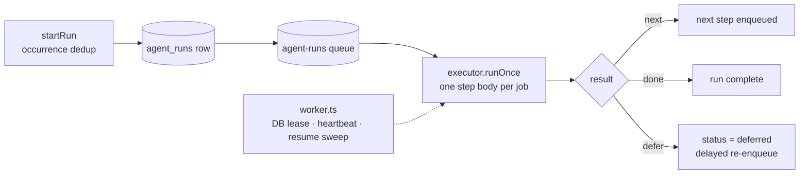
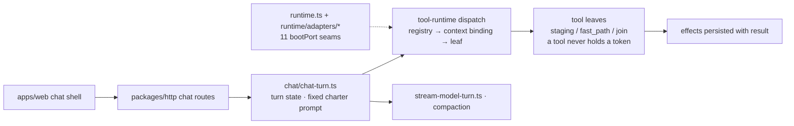
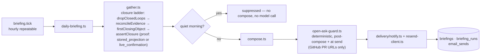
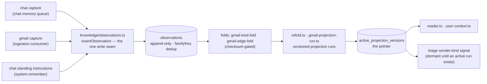
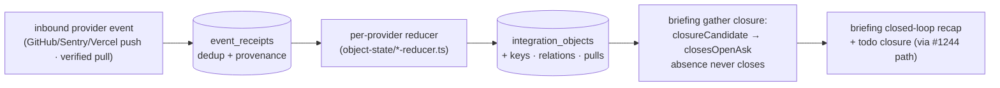

# Implementation map — where each behavior lives

A location map for the repo's major flows: one diagram + one file table per flow.
This doc says **where**; the behavior docs say **what**:

- Behavior per flow with verified gaps: [`docs/theory/product-flow.md`](../theory/product-flow.md)
- Triage behavior in full: [`triage.md`](./triage.md)
- Tool-runtime boot seams: [`tool-runtime-map.md`](./tool-runtime-map.md)
- Package boundaries: [`architecture.md`](./architecture.md)
- Concept ownership (which table holds which thing): [`../theory/context-graph.md`](../theory/context-graph.md)

Last verified: 2026-10-27 at `c1ac79cb5`.

---

## How to read a flow section

Each section answers three questions: what runs (the diagram), what owns it (the
file table), and what the table row's "owns" column means — the guarantee the file
holds, not the code it contains. Most small files in this repo are small because a
check points at them (a one-writer invariant, a compiler-checked sequence, a leaf
that breaks an import cycle); the table names that guarantee so the file count is
readable instead of alarming.

---

## Flow: email triage

The hot path. Every inbound Gmail message, minus sent mail and bulk backfills.

```mermaid
flowchart LR
  PS[Gmail Pub/Sub push] --> WH["gmail-webhook.ts (packages/http)<br/>OIDC verify · event_receipts dedup"]
  WH --> IQ[("ingestion queue")]
  IQ --> IN["gmail-ingest.ts<br/>persistMessage → documents<br/>(sent mail excluded)"]
  IN --> E1((gmail.documents_ingested))
  E1 --> CON["gmail-ingested-consumers.ts<br/>reason: webhook / ingest / null(bulk)"]
  CON --> E2((gmail.message_received))
  E2 --> SRV["execution/service.ts<br/>startRun · occurrence dedup"]
  SRV --> AQ[("agent-runs queue")]
  AQ --> WKR["execution/worker.ts + executor.ts<br/>DB lease · heartbeat · defer"]
  WKR --> S1

  subgraph WF["email-triage workflow — 4 steps"]
    S1["1 · classify"] --> S2["2 · apply-label"]
    S2 --> S3["3 · open-document-ask"]
    S3 --> S4["4 · close-loop-todos"]
  end

  S1 --> OBS["determinism spend:<br/>sender-context · observations · thread-state<br/>sender-priors · sender-relationship · sent-mail<br/>knowledge/standing-instructions"]
  OBS --> LLM["classify.ts<br/>cheap model · hedge.ts · detectConflict"]
  LLM --> FLR["floors/: override → senderKind<br/>→ spam → standing → meeting"]
  FLR --> ST["store.ts · upsertTriage<br/>thread lock · same-tx trace"]
  ST --> ROW[("email_triage<br/>one row per thread")]
  S2 --> TAGS["tags.ts · reconcileThreadLabel<br/>the one Gmail label writer"]
  TAGS --> GM[Gmail Alfred/* label]
  ST --> E3((email-triage.classified))
  E3 --> RD["reply-drafting gate (ADR-0098)"]
  ST --> RAIL[inbox rail]
  S4 --> TASKS[("todos · document_asks")]
```

### File taxonomy — `packages/assistant/src/triage/` (30 files, ~6.5K lines)

| File (lines) | Owns |
| --- | --- |
| `workflow-operations.ts` (1127) | The four step bodies, the edge table, skip paths, trace plumbing. **God-file.** |
| `classify.ts` (1077) | The rubric (`SYSTEM_PROMPT` — the only live source of category rules), the cheap-model call, `detectConflict`, the second pass, floor application. **God-file.** |
| `store.ts` (482) | The one classifier writer of `email_triage`. User-pinned no-op, recency guard, same-transaction decision trace. |
| `sender-context.ts` (400) | Deterministic From-envelope parsing (the fix for the original misclassification source). |
| `gmail-reconcile.ts` (347) | The relabel sweep job — converges Gmail when the workflow could not. |
| `floors/sender-kind.ts` (347) | Group/no-reply demotion with vetoes. |
| `sender-extraction-event.ts` (228) | Floor audits → flat trace fields (the `triage.classification` decision trace). |
| `deepen.ts` (199) | **Dead code**, documented as such. Nothing calls it. |
| `observations.ts` (195) | `assembleObservations` — the deterministic context block the model sees. |
| `sender-priors.ts` (191) | Add-only sender priors, double-teaching guarded. |
| `tags.ts` (187) | The one Gmail label writer. One-label-per-thread invariant, 404 repoint, sibling strip. |
| `thread-state.ts` (186) | Thread snippets the classifier re-reads per message (≤6 × 220 chars). |
| `floors/index.ts` (183) | `FLOOR_SEQUENCE` + positional driver — order is compiler-checked. |
| `todo-decision.ts` (150) | The todo mint gate. Fail-closed on instruction read, fail-open on closure read. |
| `sender-relationship.ts` (140) | The prose relationship line + typed `isColdContact` (model reads prose, gate reads type). |
| `hedge.ts` (134) | Hedged twin calls. Not shared: the policy fits one call site. |
| `index.ts` (129) | Public exports. |
| `floors/override.ts` (111) | The only escalating floor (exposed secret → `urgent` @ 0.85). |
| `sender-kind.ts` (98) | Sender-kind signal projection for the floor. |
| `floors/standing.ts` (83) | ADR-0110: matched instruction demotes the demand lane; security veto; fail-open on read failure. |
| `floors/meeting.ts` (82) | False-`meeting` demotion. |
| `gmail-sender-adapter.ts` (80) | Boot-port adapter (import-cycle break between ingestion and triage). |
| `email-html.ts` (75) | DOMPurify sanitization for the rail's sandboxed iframe. |
| `floors/spam.ts` (64) | Gmail-SPAM demotion of reply lanes; holds demand lanes. |
| `floors/floor.ts` (60) | The only writer of demotion rules — audit cannot disagree with verdict. |
| `sent-mail.ts` (44) | "Did the user send this?" in JS and SQL forms. |
| `email-triage.ts` (36) | The workflow registry object (slug, trigger, schemas). |
| `constants.ts` (33) | Shared triage constants. |
| `workflow-input.ts` (17) | The run input schema. |
| `rationale.ts` (8) | Leaf module so `classify.ts` and `floors/` share a helper without a cycle. |

### Why triage is 30 files

Not one file per pipeline stage — the stages are four. The split is by **guarantee**:

1. **One-writer invariants are whole files.** `store.ts` (the row), `tags.ts` (the
   label), `floors/floor.ts` (the demotion rules) each state their invariant in the
   header, so a second writer is a review-visible event rather than a grep hunt.
2. **Each floor is its own module** because each is an independently auditable
   demotion; `FLOOR_SEQUENCE` + the positional driver make the order compile-checked.
3. **The determinism bet is physical.** Five files exist purely to answer questions
   in code that the prompt otherwise would (the v2→v3 lesson: judgment shrinks
   errors, prompt prose doesn't).
4. **Import-cycle breaks are files.** The boot-port adapters and the 8-line
   `rationale.ts` exist because two owners share one helper.
5. **The accretion is in two god-files.** Step orchestration, audit plumbing, and
   the prompt rubric live together in `workflow-operations.ts` and `classify.ts`
   (34% of the dir). The small files are discipline; those two are history.

The dir is also not self-contained: standing instructions live in
`knowledge/standing-instructions.ts`, the steps run on `execution/`, the
consumers' adapters in `runtime/adapters/`, and reply-drafting is a separate
workflow in `reply-drafting/`. The diagram above is the honest shape.

---

## Flow: execution runtime (workflow engine)

Every durable workflow (triage, reply-drafting, user workflows) runs here; the
agent tool loop does not (ADR-0051 keeps them apart).

| File | Owns |
| --- | --- |
| `execution/service.ts` | `startRun`, occurrence dedup |
| `execution/queue.ts` | The `agent-runs` queue topology |
| `execution/worker.ts` | DB lease + heartbeat + resume sweep |
| `execution/executor.ts` | One step body per job; `next` / `done` / `defer` semantics |
| `execution/resolve-workflow.ts` + `registry.ts` | Workflow resolution; builtin slugs never live in the DB |
| `execution/sub-agent-join-*.ts` | Sub-agent wake (`sub-agent-join-wake` queue) |
| `execution/approval-*-worker.ts` | `pending_actions` lifecycle (expiry, notification) |
| `automation/*` | User workflow authoring, readiness, `workflows-tick` |

Tables: `agent_runs`, `agent_steps`, `pending_actions`, `agent_decision_traces`,
`agent_run_context`, `workflows`, `workflow_revisions`, `action_stagings`.
Queues: `agent-runs`, `sub-agent-join-wake`, `staging-expire`, `staging-notify`,
`workflows-tick`. Surface: `apps/web/src/routes/workflows.$workflow.tsx` + approvals routes.

---

## Flow: chat / agent harness

The one flow that runs the controller (dispatch pipeline, tools, loop). The file
layout, seams, and ADR-0089 rationale live in
[`tool-runtime-map.md`](./tool-runtime-map.md) — this section only locates them.

| Home | Owns |
| --- | --- |
| `packages/http/src/chat.ts` | Chat HTTP routes |
| `chat/chat-turn.ts` | Turn orchestration; the prompt charter; injects nothing about the user (tool calls fetch it) |
| `chat/stream-model-turn.ts`, `chat/idle-capture-queue.ts` | Streaming; `chat-memory` queue for implicit capture |
| `tool-runtime/index.ts` | 10 of the 11 boot seams |
| `tool-runtime/internal/registry.ts`, `context.ts` | Tool catalog; context binding incl. `ctx.corpus.search` |
| `tool-runtime/dispatch.ts` + `builtin-tools.ts` | Provider/db-free tool leaves |
| `runtime/runtime.ts` + `runtime/adapters/*` | Composition; `workflow-tool-catalog.ts` is the 11th seam |

Tables: `chat_threads`, `chat_messages`, `chat_thread_context`, `chat_attachments`.
Queues: `chat-memory`, `conversation-compaction`. Surface: `apps/web/src/routes/chat.$threadId.tsx`.

---

## Flow: morning briefing

| File | Owns |
| --- | --- |
| `briefings/queue.ts` + `repeatable.ts` | The hourly `briefing.tick` scheduler (`briefing-cron`) |
| `briefings/daily-briefing.ts` | `gather` → `compose` → `send` orchestration |
| `briefings/gather.ts` | Source collection; the object-state closure decision before the model runs |
| `briefings/compose.ts` | Briefing composition |
| `briefings/open-ask-guard.ts` | Deterministic open-ask guard after compose and again at send |
| `briefings/store.ts`, `read.ts`, `preferences.ts` | Persist + read + preferences |

Tables: `briefings`, `briefing_runs`, `email_sends`. Surface: `apps/web/src/routes/briefings.$date.tsx` (Replicache).

---

## Flow: reply drafting

No diagram — one consumer, one gate, one workflow.

| File | Owns |
| --- | --- |
| `reply-drafting/post-triage.ts` | The `reply-drafting-post-triage` trigger consumer of `email-triage.classified` (ADR-0098); flag-gated before any read |
| `reply-drafting/worthiness.ts` | The gate: a pure ordered rubric (flag, instruction, reply-expected category, confidence, cold-sender, todo outcome). Fail-closed on instruction read |
| `reply-drafting/compose.ts` | Draft composition (knows nothing about document asks) |
| `reply-drafting/workflow.ts` + `workflow-input.ts` | The `reply-drafting` workflow on `agent-runs` |
| `reply-drafting/decision.ts`, `verifier.ts`, `gather.ts` | Decision traces, verification, context |

---

## Flow: todos / work items

| Home | Owns |
| --- | --- |
| `tasks/suggest.ts` | Creation; merges on source overlap so re-runs don't duplicate |
| `tasks/resolve.ts` | Resolution incl. the standing-instruction sender sweep |
| `tasks/payment-reconciler.ts` | Stripe receipts close payment todos |
| `contracts/src/todos.ts` | Browser-visible status/kind/executor enums |
| `packages/db/src/schema/todos.ts` | `suggested` → `open` promotion semantics (ADR-0050) |
| `packages/sync/src/mutators/todos.ts` | Accept/dismiss mutators (Replicache) |

Tables: `todos`, `todo_events` (append-only history, ADR-0107). Surface: the
quick-access rail in `apps/web/src/lib/shell/authed-app-shell.tsx`.

---

## Flow: user model

The replayability discipline made concrete: log → fold → versioned runs → active pointer.

| File | Owns |
| --- | --- |
| `knowledge/observations.ts` | The one observations write seam |
| `knowledge/gmail-kind-fold.ts`, `gmail-edge-fold.ts` | The Gmail folds (the only active fold family) |
| `knowledge/refold.ts`, `gmail-projection-run.ts` | Versioned runs, checksum gate, activation |
| `knowledge/standing-instructions.ts` | The v1 instruction store (`user_facts`) + write-only audit observations |
| `knowledge/fact-policy.ts` | What background capture may write (`standing_instruction` is `not_writable` there) |
| `knowledge/reader.ts`, `user-context.ts` | Projection reads |
| `knowledge/drift-audit/metrics.ts` | The watch metrics (#210 lineage) |

Tables: `observations`, `observation_family_heads`, `entity_nodes` /
`entity_identities` / `entity_profiles` / `entity_edges` /
`entity_co_occurrence`, `projection_runs`, `projection_cursors`,
`projection_sync_state`, `active_projection_versions`; `user_facts`,
`user_preferences`, `style_profiles`, `memory_chunks`, `rejected_inferences`.
Queues: `memory-cron`, `chat-memory`. Surface: `apps/web/src/routes/memory.tsx`.

---

## Flow: integration object state

| Home | Owns |
| --- | --- |
| `connections/object-state/activity-consumer.ts` | One consumer per inbound source |
| `connections/object-state/store.ts` | `applyEvent` — the state store with recency/absorbing guards |
| `connections/object-state/*-reducer.ts`, `*-adapter.ts` | One reducer + adapter per provider (GitHub, Sentry, Vercel, Railway, MCP) |
| `contracts/src/integration-objects.ts` | `INTEGRATION_OBJECT_DEFS` registry (browser-safe) |

Tables: `integration_objects`, `integration_object_keys`,
`integration_object_relations` (FKs the dead `entities` table; nothing writes it),
`integration_object_pulls`; `event_receipts` in `schema/integrations.ts`.

---

## Flow: Gmail ingestion (shared entry)

Feeds triage, reply-drafting, corpus embed, user-model capture, and the rail.
Behavior in [`triage.md`](./triage.md); located in the triage diagram above (left half).

| Home | Owns |
| --- | --- |
| `packages/http/src/connections/gmail-webhook.ts` | Pub/Sub push endpoint: OIDC verify, `event_receipts` dedup, enqueue poll |
| `connections/ingestion/queue.ts` | The `ingestion-runs` worker: `poll_recent`, `poll_history`, `poll_sweep`, watch renew, per-message `media_ingest`, embed sweep |
| `connections/ingestion/gmail-ingest.ts` | `persistMessage` → `documents`; sent/inbound partition; attachment ingest |
| `connections/ingestion/repeatable.ts` | The 5-minute schedules |

Tables: `documents`, `chunks`, `ingestion_state`, `event_receipts`,
`sender_priors`. Queue: `ingestion-runs`.

---

## Flow: sync layer (Replicache)

No queue — synchronous push/pull; pokes delivered by an adapter.

| Home | Owns |
| --- | --- |
| `packages/http/src/sync/replicache.ts`, `push.ts`, `pull.ts` | The sync endpoints (`authz.ts`, `cvr.ts` beside them) |
| `packages/http/src/sync/write/*` | Mutator handlers; e.g. `write/triage-tags.ts` sets `source='user'` then enqueues the `relabelThread` followUp after commit |
| `packages/sync/src/mutators/*` | Browser-safe mutator definitions (chat, todos, triage-tags, facts, notes, prefs, workflows) |
| `packages/db/src/schema/replicache.ts` | `replicache_client_group`, `replicache_client` |
| `runtime/adapters/replicache-poke-adapter.ts` | Server events → pokes |

---

## apps/web (one line)

TanStack-Start SPA: chat threads, the todos/quick-access rail, briefing pages,
memory, workflows, approvals — mutations/streaming over the Elysia API
(`packages/http/src/index.ts`), client state over the Replicache endpoints.
