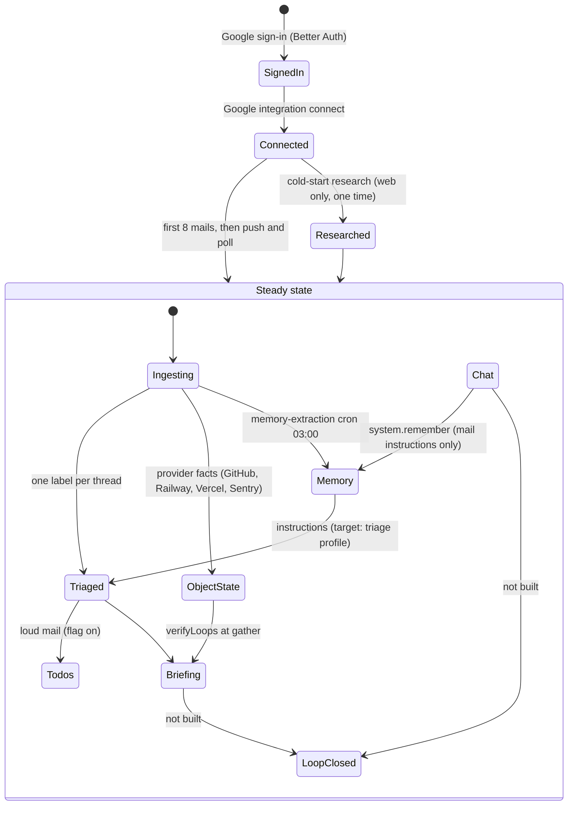

# Alfred theory: start here

This page is the entry to the theory pages. It states why Alfred exists, how a user moves through it, which design principles apply to each stage, and what to settle next. It does not repeat the stage pages. It links to them.

Read this page before you design a change, add a prompt rule, a floor, a table, or a parser, or open an ADR.

| Page                                         | What it holds                                                                 |
| -------------------------------------------- | ----------------------------------------------------------------------------- |
| [product-flow.md](./product-flow.md)         | The built flow, verified against code and production, one section per area.  |
| [triage.md](./triage.md)                     | The settled target for email triage (ADR-0121).                               |
| [context-graph.md](./context-graph.md)       | The settled model of things, links, and state.                               |
| [memory.md](./memory.md)                     | The settled theory of memory: claims, name links, and the check job (ADR-0123). |
| [product-direction.md](./product-direction.md) | The owner's plan compared with Dimension and with the built code.          |
| [state-machines.md](../reference/state-machines.md) | Each status machine, its transitions, and its invariants.              |

Last verified: 2026-11-10 at `8f7f2dbf8`. The stage facts come from `product-flow.md` and keep the commit that each section names.

---

## 1. The vision

The owner's words, 2026-11-10, in short:

- Alfred is the best personal agent experience that the owner can have.
- The owner controls the system. No assistant company that the owner does not trust holds the mail.
- Many teams build personal agents, and some do it well. Alfred must find the areas where it is behind and improve them.
- One product at a time, made good. Work on other projects waits.

**The privacy boundary, as built.** The data stays in the owner's own deployment (Postgres and the workers). The model providers and the AI gateway see the content of each model call. "No untrusted assistant company holds the mail" is true. "No third party sees any mail" is not true.

**What "good" looks like.** An example from another product (Muse, 2026-11-02). The user asked the agent to compare MacBooks. Later, two unrelated mails arrived: Apple said that an iCloud account signed in on a MacBook Air, and Wise said that a card was added to Apple Pay on that MacBook. The agent joined the two mails to the open decision from chat. It asked: "Was that you? If it was, I'll close the whole Air-versus-mini thread." Alfred cannot do this today. Section 4, item 1 explains why.

---

## 2. The principles

Each principle comes from an owner correction. The tag says when the correction came:

- **Early:** the owner said it in a conversation, before a fault.
- **Late:** a production fault showed the problem, often months after an early correction.

The usual pattern: the owner states the principle early, and the agent applies it to the current diff only. The same fault then comes back in production. Thus **one owner correction is a rule for the whole area, not for one diff.** The owner's principles are not perfect, but the vision comes first. If a principle and the vision disagree, raise it with the owner. Do not work around it.

1. **A fix that only adds a rule is a warning.** The warning applies to a new prompt line, floor, regex, or sender list. Name the principle that the fault breaks. Make the fault an eval case. *(Early 2026-06-02 and 06-26; late 2026-11-06: the triage prompt grew to 38 rules, and 21 of the 41 commits to `classify.ts` after 09-01 are fixes.)*
   Touches: triage, chat tool selection, todos, briefing copy.
2. **Know when to stop and rethink.** Stop patching and write the theory (the job, and what counts as an error) before code, when one of these occurs:
   - An area gets its third patch.
   - A patch changes the behavior of nearby rules.
   - The same input gets different results with no new evidence.
   - Each fix opens more follow-up work than it closes.
   *(Late: the chess.com streak mail got 4 labels. A campaign grew from 3 items to 53, which the owner called "spiralling".)*
   Touches: every area. It applies most to triage and to campaigns.
3. **Reuse before you make.** Before you design, read `decisions.md`, these theory pages, and `sessions search`. Before you write a parser, a field, or a table, find the existing one. *(Early, two times: on 2026-11-04 a new loop object duplicated the context graph. On 2026-11-10 two sessions designed ADR-0121 again, and triage parses recipients again when `knowledge/gmail-reducer.ts` already parses them.)*
   Touches: context graph, memory, triage input, integrations.
4. **Facts go in, the model judges, and code owns only guarantees.** Give the model the facts in the words of the source. Do not change them into code verdicts (booleans, sender lists, floors). Code decides only what must never be wrong: security, the user's own correction, and a named person. *(Early and repeated: "no hardcoded bot slugs" on 05-26, 06-02, and 06-09. Late: a stock instruction became 13 sender addresses and lost its meaning.)*
   Touches: triage, standing instructions, connection copy, briefing.
5. **The system must not learn from itself.** Only what the user did is evidence. *(Late: `incrementSenderPrior` counts the model's own label, and production has 0 user corrections in 1,512 triage rows.)*
   Touches: triage priors, memory, the user model.
6. **The product job comes before the mechanism.** The owner decides the job of a feature, the worst error, the label set, and what Alfred may do alone. The agent decides parsers, schemas, and code shape. Dimension is a research input, not a default, because Alfred has one user. *(Early: Ably and TurboPuffer were rejected. CI failures are `fyi` because of the owner's workflow. The 2026-11-04 sweep closed 97 issues that gave no product gain.)*
   Touches: every new feature and ADR.
7. **The fewest moving parts.** Use the fewest functions, interfaces, and lines that do the job. Do not overload the model: send what it needs, in a clear shape. *(Early, 2026-11-10: send a trimmed object of mail facts, not a second model call and not the full raw message.)*
   Touches: triage input, chat prompt, tool surface.

---

## 3. The user lifecycle

Each stage has two states. They change separately.

**Theory state** (is the design thought through?):

- **Settled.** The owner approved a theory page or an ADR for it.
- **Partly.** Some pieces are settled. Other pieces are open, and the page names them.
- **Open.** Nobody has thought it through yet.

**Code state** (is it built?): **Built**, **Partly**, or **Not built**. "Built" means the code does what the theory says. Old code that a settled theory replaces is **Not built**, because the target is not built.

A stage can be Settled and Not built, or Open and Built. Both are valid states. Name the state before you work on a stage:

- **Settled, not built:** build it, slice by slice, with its gate.
- **Partly:** settle the open pieces with the owner first. Build only the settled pieces.
- **Open:** do theory work first (grill the owner, then write a theory page or an ADR). Do not write code, and do not patch the old code to cover the gap.

| Stage                  | Theory                                                                 | Code                                     | Detail                                                                                                    | Principles | Open pieces or largest gap                                                                                                                      |
| ---------------------- | ---------------------------------------------------------------------- | ---------------------------------------- | --------------------------------------------------------------------------------------------------------- | ---------- | ----------------------------------------------------------------------------------------------------------------------------------------------- |
| Sign-in and connect    | Settled (as built)                                                     | Built                                    | [product-flow §1](./product-flow.md#1-cold-start-research-about-the-user)                                 | 6          | Sign-in does not start research. Only the Google integration connect starts it.                                                                 |
| Cold-start research    | Partly                                                                 | Built, web only                          | [product-flow §1](./product-flow.md#1-cold-start-research-about-the-user)                                 | 3, 4       | Open: the mailbox and the calendar as inputs, and research when a new integration connects.                                                     |
| Ingest                 | Partly                                                                 | Built                                    | [product-flow §3](./product-flow.md#3-email-tagging-triage)                                               | 3, 7       | Open: the mail-state model. Alfred stores a mail as it was at arrival. A read or a relabel in Gmail is not seen.                               |
| Triage                 | Settled (ADR-0121, [triage.md](./triage.md))                           | Not built (slice 0 only)                 | [triage-theory-v1.md](../plans/triage-theory-v1.md)                                                       | 1, 2, 4, 5 | Open: the shape of the mail facts that the model reads.                                                                                         |
| Todos                  | Settled (ADR-0121 decision 12: a follow-up that never changes a label) | Not built (old producer, flag off)       | [product-flow §2](./product-flow.md#2-action-items-todos)                                                 | 1, 6       | Object state does not close a todo. Only Gmail mints one.                                                                                       |
| Object state and loops | Settled for provider objects ([context-graph.md](./context-graph.md)) | Partly                                   | [product-flow §4](./product-flow.md#4-briefings-and-object-state)                                         | 3, 4       | Open: a loop that starts from chat or that crosses sources.                                                                                     |
| Briefing               | Partly                                                                 | Built                                    | [product-flow §4](./product-flow.md#4-briefings-and-object-state)                                         | 4, 7       | It reports loops. It cannot close one or ask the user to verify one.                                                                            |
| Chat                   | Partly                                                                 | Built                                    | [product-flow §5](./product-flow.md#5-chat-the-boss-agent)                                                | 1, 4, 7    | Chat cannot see briefings or triage labels. Alfred cannot send a message outside a turn.                                                        |
| Memory over time       | Settled (ADR-0123, [memory.md](./memory.md)), except Q6                | Not built (old direct writes)            | [memory.md §8](./memory.md#8-theory-state-and-code-state)                                                 | 1, 4, 5    | No name lookup, no evidence on claims, no check job (needs Code Mode, #535). Open: Q6 (unconfirmed claims and their UI), the triage profile (ADR-0121 decision 6). |
| Loop closing and asks  | Open (ADR-0121 plan: "needs its own session")                          | Not built                                | none yet                                                                                                  | 2, 4, 6    | The Muse example. See section 4.                                                                                                                |

---

## 4. What to work on next: foundations first

A foundation is a piece that many later stages read. Build a settled foundation before the stages that depend on it. Think through an open foundation before anyone builds on top of it.

| Foundation                                   | Theory  | Who reads it                                                     |
| -------------------------------------------- | ------- | ---------------------------------------------------------------- |
| One reader of the stored mail (mail facts)   | Partly  | Triage, loop joins, briefing, the user model                     |
| Only the user's actions are evidence         | Settled | Triage, memory, the triage profile                               |
| A tracked thing for each open matter (loop)  | Partly  | Loop closing, asks, briefing, todos, chat                        |
| Memory: claims with evidence, name links, the check job ([memory.md](./memory.md)) | Settled | Chat (resolve a name), triage, briefing, loops from chat, the triage profile |

The order:

1. **Triage under ADR-0121, starting with its foundations.** The theory is settled, so build it. The first two slices are foundations: the mail-facts reader (from `documents.raw`, so the model can judge if a mail is real) and the stop on self-learning (slice 1). The plan is in [triage-theory-v1.md](../plans/triage-theory-v1.md).
2. **Theory work on loops that cross sources and start from chat.** This is the largest gap against the vision, and its theory is open. Do not write code yet. The Muse example needs four things:
   - Chat keeps an open matter (a decision, a purchase) as a tracked thing.
   - New evidence from any source (two mails from two senders) joins to that thing.
   - Alfred speaks first, outside a turn.
   - Alfred asks the user to verify before it closes (the autonomy ladder: report, verify, close).

   To settle with the owner: is an open matter from chat a thing in the context graph? Which evidence may join to it, and who decides the join (the model, by principle 4)? When may Alfred speak first?
3. **Memory, built from its settled theory.** [memory.md](./memory.md) settles claims with evidence, name links, chat capture, and the check job. It depends on the context graph, not on the loop theory. Build it in the order of memory.md section 10. The check job waits for Code Mode (#535). The triage profile is still open, and an open matter from chat waits for the loop theory from item 2.
4. **Cold start from the mailbox and the calendar.** The first day is the first impression. It depends on the mail-facts reader from item 1.

---

## How to keep this page current

- Update a stage row in place when its theory state or code state changes. Do not add a changelog.
- Add a principle only when an owner correction does not fit an existing one. Merge before you add.
- When a stage gets a full section, link to it from its row and keep the row short.
